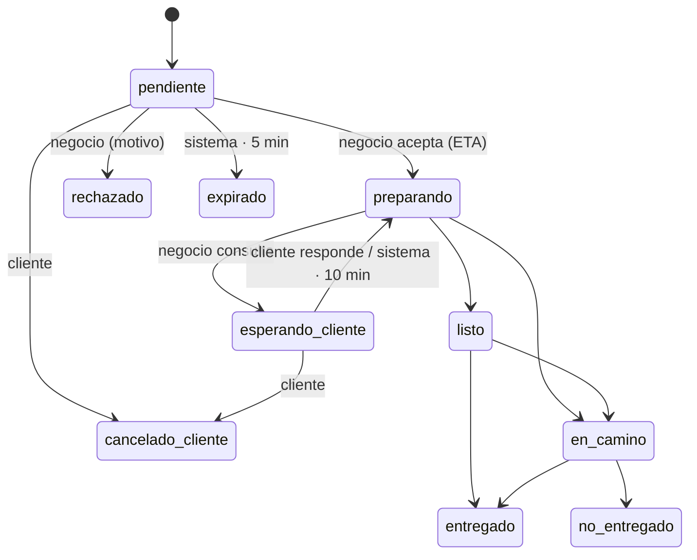

# Mandadito · Delivery local para Sociedad, Morazán

App de pedidos a domicilio para varios negocios (tipo mercado en línea) para comercios de un municipio pequeño de El Salvador: pupuserías, tiendas, farmacias y ferreterías. Una sola app con dos modos: el **cliente** pide y paga en efectivo al recibir; el **negocio** recibe el pedido en tiempo real, lo acepta con tiempo estimado y lo despacha. Acceso sin contraseña con código por WhatsApp.

| Modo | Qué hace |
|---|---|
| Cliente | Explora negocios por categoría y zona · pedido con opciones (masa, extras, nota) · compra **por monto** a granel (“$1 de tomate”) · domicilio o recoger · efectivo con cálculo de cambio · seguimiento del pedido y calificación |
| Negocio | Pedidos en tiempo real con **sonido, vibración y notificaciones** · aceptar con ETA o rechazar con motivo · **consultar al cliente** (sustituciones, precios) · salió a entregar / entregado y cobrado · apagar productos agotados · pausar el negocio |

| Capa | Tecnologías |
|---|---|
| App (Android · iOS · web) | Expo SDK 58 · React Native 0.88 · React 19 + React Compiler · Expo Router · TypeScript estricto |
| Backend | Firebase Cloud Functions v2 (Node 22) · Firestore · Firebase Auth (tokens personalizados) · Cloud Scheduler |
| Notificaciones | expo-notifications + servicio de notificaciones de Expo (FCM/APNs) · canal de Android con prioridad máxima y sonido propio |
| Calidad | Vitest (15 pruebas de reglas de negocio) · ESLint · `tsc --noEmit` · expo-doctor 20/20 |
| Distribución | EAS Build: APK para pruebas y paquete AAB para Google Play |

## Estructura

```
app/                 App Expo: cliente y negocio en el mismo código
  src/app/           Pantallas (Expo Router, rutas por archivo)
  src/components/    Sistema de diseño: Button, Field, Chip, AddStepper, ConTeclado…
  src/data/          DataSource: firebase.ts (producción) · mock.ts (demo sin red) · notificaciones.ts
  src/state/         Sesión, carrito, registro de notificaciones
functions/           Cloud Functions
  src/auth.ts        Código de acceso (OTP) y sesión con token personalizado
  src/pedidos.ts     Crear pedido, cambiar estado, calificar, vencimientos programados
  src/notificaciones.ts  Avisos por cambios en pedidos · registro de celulares · borrado de cuenta
shared/              Reglas de negocio puras (precios, envío, mínimo, cambio, estados) + pruebas
scripts/             sync-shared.mjs: copia shared/ a la app y a las Functions
firestore.rules      Seguridad de la base de datos
```

## Ingeniería

**Una sola fuente de reglas.** Totales, envío por zona, pedido mínimo, cambio en efectivo y la máquina de estados están en [`shared/src`](shared/src) y se copian a la app y al servidor. El cliente ve exactamente el total que el servidor va a cobrar.

**El servidor manda.** La app solo indica qué productos y cuántos; [`crearPedido`](functions/src/pedidos.ts) relee los precios desde Firestore, recalcula con las reglas compartidas y registra el pedido en una transacción (código correlativo y control de pedidos pendientes). Dinero siempre en **centavos enteros**.

**Máquina de estados con permisos por rol.** Cada transición declara quién puede ejecutarla; [`aplicarTransicion`](shared/src/orderState.ts) es una función pura que deja historial auditado. Una función programada vence pedidos no aceptados (5 min) y consultas sin respuesta (10 min).



**Notificaciones confiables para el negocio.** Un disparador `onDocumentWritten` sobre `pedidos/{id}` avisa al negocio de cada pedido nuevo y al cliente de cada cambio de estado. Los celulares que desinstalaron la app se eliminan solos de la lista según la respuesta del servicio de Expo.

**Modo demo sin servidor.** Las pantallas dependen de la interfaz `DataSource`; un servidor simulado en memoria usa las mismas reglas compartidas, así se puede probar el flujo completo sin Firebase.

**Pensado para el contexto local.** Pago contra entrega con selector de billete y cálculo de cambio (sin pasarela ni datos de tarjeta), compra por monto para mercado, manejo del teclado y de los bordes de pantalla en Android, botones que no se cortan con letra grande y etiquetas de accesibilidad.

## Arranque

Modo demo (sin Firebase). Código de acceso: `123456`.

```bash
cd app
npm install
npx expo start            # "w" abre la versión web · Expo Go para el celular
```

En **Cuenta → Cambiar a mi negocio** se reciben y aceptan los pedidos hechos como cliente.

Pruebas de reglas de negocio:

```bash
cd shared && npm install && npm test
```

Producción (Firebase en plan Blaze):

```bash
firebase use --add
cd functions && npm install && cd ..
firebase deploy --only "firestore,functions"
# app/.env.production con la configuración web de Firebase, luego:
cd app && eas build -p android --profile preview
```

## Seguridad

- Ninguna llave ni contraseña en Git (`.gitignore`: `.env`, `functions/.env`, llaves de cuentas de servicio). La configuración web de Firebase es pública por diseño; la protección está en las reglas y en el servidor.
- **Reglas de Firestore de mínimo privilegio:** el teléfono no puede escribir pedidos; cada cliente lee solo los suyos y cada negocio solo los de su comercio; el dueño solo puede cambiar `abierto` y `disponible`.
- **OTP:** el código se guarda como hash SHA-256, vence a los 10 minutos y tiene límite de envíos por hora y de intentos.
- **Borrado de cuenta** desde la app, con anonimización del historial de pedidos (requisito de Google Play y App Store).

## Hoja de ruta

- [x] Flujo cliente ↔ negocio en tiempo real, estados, vencimientos y consulta al cliente
- [x] Notificaciones, borrado de cuenta y compilación de Android con EAS
- [ ] Beta cerrada con comercios de Sociedad
- [ ] Importación de catálogo desde Excel y reporte mensual por negocio
- [ ] Firebase App Check y monitoreo de errores
- [ ] API para negocios (llaves de acceso y avisos automáticos) para conectar sistemas de inventario y punto de venta

---

**Maguiber Stifen Ramos Flores** · Full-Stack & Cloud Developer · [maxi300.github.io](https://maxi300.github.io)
